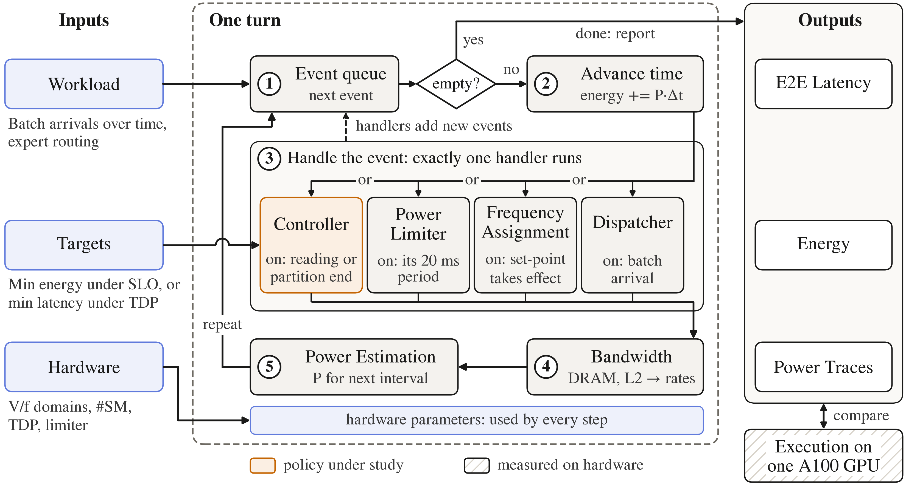
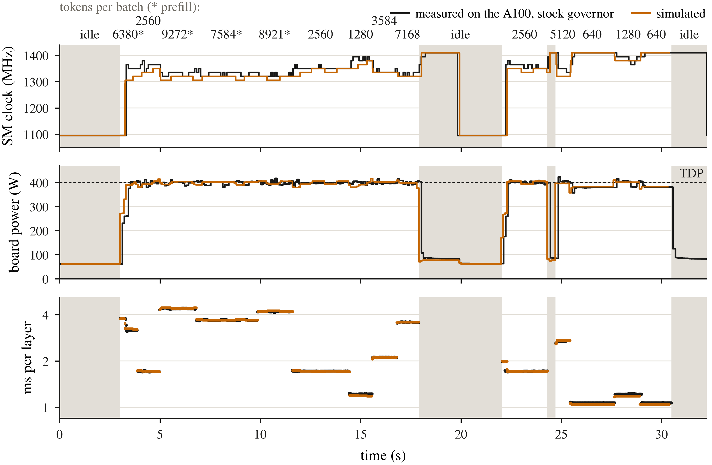

# Simulating V/f Domains That Do Not Exist

No shipping GPU lets two groups of SMs run at different voltages and frequencies; the
A100 we measure has one V/f domain. To evaluate a two-domain design we build an
event-driven simulator of MoE inference, calibrate it on the one-domain A100, and trust
its two-domain answers only as far as it reproduces what the A100 can show. Every
quantity a one-domain chip cannot determine is a named parameter that we sweep
(Section 5).

## 1. Why a mechanistic model

A table from (configuration, clock) to (time, power) covers the configurations that were
measured. A two-domain design needs three things no such table holds. First, two
partitions on disjoint SM sets share DRAM and the L2, so each slows the other by an
amount that depends on both clocks. Second, the board's power limiter moves the clock at
run time, in response to a power that itself depends on the clock. Third, a layer waits
at a barrier for its slowest partition: slowing the partition that finishes early is
free, but only until it becomes the slowest. All three couple the domains, and the last
two are dynamic. The model is therefore mechanistic: a few physical parameters, each
identifiable on one domain, whose meaning carries over when the clocks differ.

## 2. Model

Figure 1 shows the simulator as one turn of its event loop. Its inputs are a workload
(batches of MoE layers with their routing, arriving over time), a target for the
controller, and a hardware description (SMs, V/f domains, TDP, the power limiter); its
outputs are the latency and energy of every layer and a trace of clocks and power. One
turn takes the next event from the queue (step 1), advances time to it (2), runs that
event's handler (3), solves the rates of everything still running under the shared DRAM
and L2 (4), and computes the board power that holds until the next event (5). The
paragraphs below describe what each step computes.

**Workload and demand.** A batch is a list of MoE layers and a layer is a routing
histogram $c_e$, the number of (token, expert) pairs of each expert, taken from routing
traces of the real model. A layer is two grouped GEMMs, separated by an activation and
followed by the top-$k$ sum. The kernel sorts the pairs by expert, pads each expert's run
to a multiple of $B_M$ rows and cuts each such *row-block* into tiles of $B_N$ output
columns. When a batch arrives, the dispatcher splits each layer into partitions; a
partition $p$ is a set of experts that runs on the $n_p$ SMs of one domain. The histogram
alone gives what a partition asks of the hardware: $\sum_{e\in p}\lceil c_e/B_M\rceil$
row-blocks, one weight panel streamed to the SMs per row-block, the multiply-accumulates
(MACs) on real pairs and on padding rows, and the bytes that must come from DRAM (each
live expert's weights once, plus activations). Against hardware counters for 90 kernels
this decomposition matches tensor-core instructions exactly and DRAM bytes read to a
median of $-0.1\%$ (worst $-17\%$).

**Rate (step 4).** With one resident thread block per SM, the $n_p$ SMs of a partition
cover a *window* of $n_p$ consecutive tiles at any instant. A window $w$ takes the time
$t_w$ that solves

$$
n_p\,t_w \;=\; \frac{k_P(f_p)\,B_w}{1-\rho_L}
            \;+\; k_R(f_p)\,M_w
            \;+\; \frac{L_0(f_p)\,D_w}{1-\rho_D}, \tag{1}
$$

where $B_w$ is the window's panel bytes, $M_w$ its MACs and $D_w$ the bytes its SMs wait
for from DRAM. The two utilisations count *all* traffic on the chip, including the
window's own $D_w/t_w$ and $B_w/t_w$:

$$
\rho_D = \frac{S_D}{\mathit{BW}_D}, \qquad
  \rho_L = \frac{S_L}{\mathit{BW}_L(f_u)} + \xi(f_p)\,\rho_D^{\,q} . \tag{2}
$$

Each window is thus a one-dimensional root-find, and partitions that run side by side are
a fixed point in which each sees the others' streams. Per-SM costs have the form
$k(f)=a/f+b$; the shared capacities move with the clock as powers of it,
$\mathit{BW}_L\propto f_u^{\gamma_L}$ and $\xi\propto f_p^{\gamma_\xi}$. This one mechanism
gives both effects we measured: a partition saturates as it is given more SMs, because
its own traffic fills the shared resources, and two partitions slow each other, because
each sees the other's traffic. The second term of $\rho_L$ is what a neighbour adds
beyond its share of the bandwidth: a partition that streams from DRAM slows its
neighbour's L2 hits, and by more the closer DRAM is to full. Congestion is evaluated per
window and not per pass because it is convex: a layer alternates between windows of cold
experts, in which every SM pulls a distinct panel from DRAM, and windows inside one hot
expert, which touch DRAM not at all. One average utilisation per pass under-predicted
such layers by 6–13%.

When domains differ, $k_P$, $k_R$, $L_0$ and $\xi$ follow the partition's own clock
$f_p$; $\mathit{BW}_L$ follows the clock $f_u$ of the shared logic; $\mathit{BW}_D$
follows none. These attributions cannot be checked on one domain and are among the
assumptions of Section 5.

**Power (step 5).** Board power is a sum over what the hardware does per second, not a
table of configurations:

$$
P \;=\; P_{\mathrm{idle}}(\mathbf f) + P_{\mathrm{act}}(\mathbf f)
     + \sum_{j}\Big[\, g(f_j)\big(e_P\dot B_j + e_M\dot M^{\mathrm{real}}_j
                                   + e_Z\dot M^{\mathrm{pad}}_j\big)
                     + e_D\dot D_j \Big], \tag{3}
$$

summed over running jobs $j$. $g(f)$ is the square of the supply voltage relative to its
floor, fitted as one number per clock; it is flat within 3% up to 990 MHz and reaches
1.83 at 1410 MHz. Two findings shaped Eq. (3). DRAM traffic costs the same energy at
every clock ($e_D = 77.6$ mJ/GB; refitted clock by clock it stays within
74.8–81.4 mJ/GB from 510 to 1410 MHz), while the SM-side energies follow $g$. And a MAC
on a padding row costs 35% of a MAC on a real pair, although it takes as long: time
follows padded rows and energy follows real pairs. With several domains, the
clock-dependent part of idle power is divided by SM count, and a share $u$ of it follows
the shared logic's clock.

**Events (steps 1–3).** Between two events every rate and the power are constant, so the
simulator jumps from event to event and integrates energy exactly. Exactly one handler
runs per event: the dispatcher when a batch arrives; the controller on a reported power
reading or when a partition finishes a GEMM; the power limiter on its own period; and
frequency assignment when a clock set-point takes effect. A handler may schedule further
events, and after it the rates of everything still running are solved again. A layer is
four stages (GEMM 1, activation, GEMM 2, sum) with a barrier after each. Because a
partition finishing is an event, a policy can act at that instant — for example, raise
the domain that is still running — and the simulator charges it the actuation delay
before the new clock takes effect.

**Power limiter and governor.** The limiter belongs to the hardware model and applies to
every configuration alike. NVML refreshes about every 100 ms, too slowly to characterise
it, so we timed every CUDA-graph replay (4 layers, 4–16 ms) of a scripted load: a layer's
time follows the clock, which makes the replays a clock witness ten times finer than
NVML. In 16 steps to a heavier batch the A100 held the old clock for 9–26 ms and had
reached its new level, 45–117 MHz lower, by 43–153 ms (median 58 ms); in 15 steps to a
lighter one it was back up by 57–116 ms (median 77 ms). The model follows: every 20 ms
the limiter reads the mean board power; above $1.05\times$TDP it lowers the clock ceiling
by 0.45 MHz per watt of excess, effective 10 ms later; inside that band it accumulates
the excess as energy and moves one 15 MHz step per 4 J. The stock governor parks an idle
chip at 1095 MHz, wakes it 0.25 s into a load and parks it again after 2 s without one.

**Controllers.** A controller requests a clock per domain; a request takes effect after an
actuation delay (38 ms through NVML on the A100) and is clipped to the limiter's ceiling.
Beside the stock governor and a fixed clock we implement `tdp_bisection`, which finds the
clocks that finish a layer soonest with predicted power under TDP by nested bisection (an
outer search on the layer time, an inner search per domain for the slowest clock that
still meets it); `boost_on_finish`, which raises the domain still running when the
other's partition finishes; a model-free closed loop; and an exhaustive offline optimum.
Model-based controllers call the simulator's own one-layer predictor, so a policy cannot
look good through a mismatch between the model it plans with and the model it is scored
on.

## 3. Calibration

Table 1 lists the fits. All data are from one A100-SXM4-40GB with the clock locked per
measurement; the model is Qwen3-30B-A3B (128 experts, top-8). The rate model of our
persistent kernel has nine free parameters, fitted at once to 2964 times of partitions
running alone on 16–108 SMs and beside a partner on six SM splits, at 15 clocks from 510
to 1410 MHz. vLLM's kernel shares the chip's capacities ($\mathit{BW}_D$,
$\mathit{BW}_L$, $\xi$, $q$) and has its own per-SM costs.

*Which parameters are free was decided on data the fit had not seen.* We fitted three
forms of Eqs. (1–2) on the first sweep alone (1170 times) and scored each on the two
sweeps collected after it: eight other configurations at 990–1380 MHz (994 times), and
the first sweep's configurations at 510–870 MHz, below its range (800 times). The form in
use frees $q$, $\gamma_L$ and $\gamma_\xi$ and fixes $\mathit{BW}_D$ at the memory's
nominal 1555 GB/s; it predicts the two later sweeps to 3.8% and 2.7% rms. Fixing
$\gamma_L=\gamma_\xi=1$ gives 3.8% and 3.0%; fixing $q=1$ as well and freeing
$\mathit{BW}_D$ gives 4.2% and 3.1%. The form in use is also the most accurate of the
three on 22 of the 34 never-fitted rows behind Table 2 and on every moving-load trace
outside the registered test. With $q$ and $\mathit{BW}_D$ both free the two trade against
each other and $\mathit{BW}_D$ runs off to 25–34 TB/s, which is why it is fixed. The
fitted exponents are $\gamma_L = 0.44$, $\gamma_\xi = 1.49$ and $q = 1.72$: the L2 serves
faster at a higher clock but far less than in proportion, and the coupling grows faster
than DRAM utilisation. The per-SM costs and the capacities are determined to 0.2–8% (one
standard deviation) and the three exponents to $\pm$0.06–0.08, except the
clock-independent part of $k_P$ (19%).

*Each window's root-find must be iterated to convergence.* Near DRAM saturation Eq. (1)
is almost singular and Newton's method creeps. Stopped after a fixed small number of
steps, a saturated window is up to a percent off and a co-running partner's time becomes
a jagged function of it; the fixed point between the two then has no single answer and
the least-squares problem no single optimum. An earlier version of our calibration had
this defect. Solved to convergence, four different starting points reach the same
optimum.

The epilogue (activation and top-$k$ sum) is the loosest fit, 8.1% rms; it is 9–19% of
a layer's time, so it contributes at most 1.5% to a layer.

**Table 1.** Calibration. Time errors are $\ln(\text{sim}/\text{meas})$; power errors are
relative to board power.

| Fit | Data | Free | rms |
|---|---|---|---|
| Rate, persistent kernel | 2964 solo and co-run times | 9 | 3.1% |
| Rate, vLLM kernel | 197 whole-layer times | 4 | 1.9% |
| Epilogue time | 118 layers | 3 | 8.1% |
| Board power | 2261 records | 4 + 2 per clock | 2.3% |
| Idle power | 41 clocks, 210–1410 MHz | table | – |

## 4. Validation

Table 2 goes from what the model was fitted on to what it never saw. Board power includes
55–77 W of idle power, which is a measured table the model cannot get wrong, so the table
also gives the power error relative to the power above idle. Three results carry the most
weight.

*The pinned layer.* The configuration a two-domain design executes — both partitions
pinned to their own SM sets, barriers between the stages — was measured end to end in six
cases, on six SM splits and at three clocks, and was not fitted. Its time varies fourfold
across splits; the simulator is within 1.4% rms (worst $+4.2\%$; the six cases
separately, 0.6–2.4%). For 94 of the 108 records the calibration sweeps had run the same
two partitions side by side on the same split, so for those the test is of composition —
barriers, epilogue, event loop — and not of new partitions. The other 14 come out at
0.7%.

*A moving load, registered in advance.* The first five trace rows were replayed while the
limiter model was being built, so they are not a clean test. For one that is, we froze
the simulator and its parameters, drew two 33 s load scripts from a fixed random seed —
batch sizes, prompts, a layer and decode routing that no earlier measurement had used —
and fixed pass criteria before running them on the A100. Each was replayed through the
frozen simulator once (Figure 2). Latency per layer is within 0.9–1.6% rms, board power
within 0.6–1.6%, and the energy of each of the six runs within $-0.5$ to $-1.7\%$. Four of
the five registered criteria pass on both traces; the clock criterion misses on one
(21.6 MHz rms against a limit of 20), where the chip's wake from its parked clock came
0.11–0.33 s after the load and the simulator always wakes at 0.25 s. After that test the
calibration was repaired as described in Section 3. Replayed again with the repaired
calibration — not a registered test — the same two traces give 0.7–1.6% in latency,
0.5–1.8% in power and $+0.0$ to $-1.1\%$ in energy.

*A policy change.* Locking the clock is the one policy we can also apply to the real
chip. Against the stock governor on the same load, a fixed 1050 MHz clock was measured at
$+15.9\%$ time and $-26.0\%$ energy; the simulator gives $+17.3\%$ and $-23.9\%$. For a
fixed 1290 MHz clock the measurement is $+1.7\%$ and $-9.5\%$ and the simulator
$+1.8\%$ and $-7.9\%$: it gets the size of a policy's effect right to about two points
and errs toward understating the saving.

**Table 2.** Validation against the A100. "Fit" says whether the calibration used the
records. Power rms is relative to board power and, in parentheses, to board power above
idle.

| Check | Fit | Time rms | Power rms |
|---|---|---|---|
| Calibration sweeps, 510–1410 MHz (2964 times) | yes | 3.1% | 2.3% |
| The two later sweeps, scored before they were fitted (994, 800) | no | 3.8%, 2.7% | – |
| Earlier campaigns, other days (569) | no¹ | 0.5–6.1% | 1.4–5.5% (2.5–10.4%) |
| Four other MoE layers (1112) | no | 3.4–5.8% | 2.4–5.0% (3.3–9.4%) |
| Pinned layer end to end (108) | no | 1.4% | 2.3% (3.5%) |
| Whole layers, fitted sweeps, both kernels (315) | yes | 1.8–2.2% | 1.7–2.2% (2.2–3.0%) |
| Whole layers, never fitted, both kernels (115) | no | 0.9–2.5% | 1.8–2.7% (2.3–3.6%) |
| Moving load, five traces (121 segments) | seen | 1.0–2.7% | 0.7–1.7% |
| Moving load, registered in advance (66 segments) | no | 0.9–1.6% | 0.6–1.6% |
| Load step, per replay (1834 replays) | no | 0.9% | – |
| OLMoE, Qwen3-Next (428) | no | 1.9–3.4% | 2.6–4.6% (3.6–6.4%) |
| Granite, another hidden size (178) | no | 5.1–8.1% | 6.1–7.4% (8.5–10.1%) |

¹ One of the ten sweeps (32 records) supplied the voltage curve between two calibration
clocks.

## 5. What one domain cannot tell us

Eight properties of a two-domain chip are not facts but parameters of the hardware
description: which clock the shared logic (L2, crossbar) follows; how much of the
clock-dependent idle power belongs to that logic; what a crossing between two clock
domains costs an L2 delivery; whether the lower rail has its own converter or hangs off
the higher one through an LDO, in which case its saving is linear in voltage rather than
quadratic; how much of an SM's panel-delivery cost follows the shared logic's clock
rather than its own; which clock the coupling $\xi$ follows; whether the extra power of a
loaded die follows each domain's clock or the faster one; and which clock the epilogue
runs at. To these we add one choice of ours, the form of the rate model (Section 3). The
evaluation reports every two-domain result under each setting. For a fixed partition (64
cold experts on a 32-SM domain), the energy a second rail saves at the latency of a
1290 MHz single clock ranges over the fourteen settings from 1.1% to 4.7% for a
2048-token decode batch on our kernel, and from 0.0% to 3.8% for a 4096-token batch with
vLLM's per-SM costs; the smallest value in each case is the LDO's. It never becomes a
loss, because a two-domain configuration contains the one-domain one. Two identities
guard the extrapolation: two domains given the same clock reproduce the one-domain pinned
kernel to rounding ($4\times10^{-16}$), and the energy of a run equals the integral of
its power trace.

## 6. Limits

The simulator's error on a single configuration is 2–4%, so it cannot resolve effects
below about 2%; differences between two configurations that share partitions are better
determined than either alone, but an effect of that size cannot be told from zero. The
pinned kernel we could verify keeps one thread block per SM and is 11–25% slower than
vLLM's; results that assume a pinned kernel as efficient as vLLM's are a what-if, not a
measurement. The model has no thermal state: after an idle gap the board draws 10–20 W
less for 2–5 s, and the real clock sits 15–45 MHz above the simulated one meanwhile.
Batches of 512–1024 tokens at clocks above 1350 MHz are 4% slower than simulated. The
governor and limiter are eight numbers set by hand against one trace. The calibration
transfers to models with the same hidden size (OLMoE, Qwen3-Next) and not to one with
another (Granite is 4–10% slower than simulated at every SM count, with the energy per
pass correct), so a model with another hidden size needs its own sweep.

---

**Figure 1.** One turn of the simulator's event loop. The next event is taken from the queue
(1) and time advances to it (2). Exactly one handler runs (3): the controller, on a
reported power reading or when a partition finishes; the power limiter, on its 20 ms
period; frequency assignment, when a set-point takes effect; the dispatcher, when a batch
arrives. The rates of everything still running are then solved under the shared DRAM and
L2 (4), and the board power for the next interval follows (5). The outputs are compared
with the same load executed on one A100.

**Figure 2.** A load registered before it was measured, on the A100 under the stock governor
(black) and in the frozen simulator (orange): SM clock, board power and time per MoE
layer. Batch sizes, prompts and the layer were never used before.
